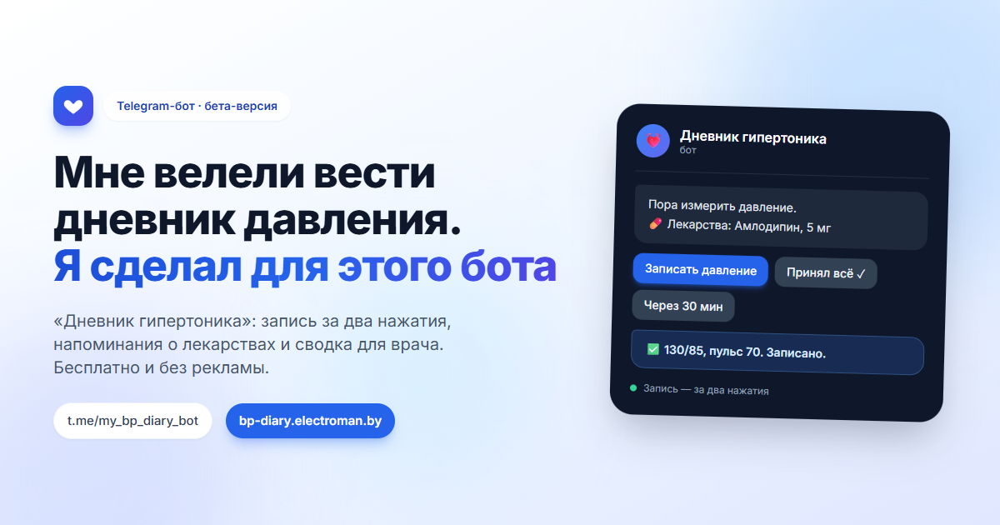

# Мне велели вести дневник давления. Я сделал для этого бота

У меня гипертония. Не та, про которую шутят «ну, от начальника», а та, из-за которой врач смотрит серьёзно и говорит: меряйте давление утром и вечером, записывывайте и приносите дневник на приём.

Записывать я пробовал по-разному. Блокнот рядом с тонометром — продержался неделю, потом блокнот куда-то уехал. Заметки в телефоне — терпимо, пока не нужно посчитать среднее за месяц. Excel на телефоне — это отдельный вид мазохизма. И каждый приём начинался одинаково: «А какая была динамика за последние недели?» Я честно показывал фотографии экрана, и было видно, что доктору от них примерно столько же пользы, сколько мне от моего «ну, вроде норм».

Я пробовал и специальные приложения для дневника давления. У них одна общая беда: они выглядят так, будто следить за давлением — это хобби. Графики, цели, интеграции, аккаунты, облака, подписка через две недели, реклама сверху. А мне нужно было совсем простое: открыл, нажал две кнопки, закрылся. Потому что если запись занимает дольше, чем само измерение, дневник умирает через неделю. Проверено на себе, дважды.

Я разработчик, и в какой-то момент до меня дошло, что никто не мешает мне написать того бота, которого мне не хватает. Не приложение со складом функций, а маленького, злого, для одной задачи. Сделал его в Telegram: устанавливать ничего не надо, он открывается везде, уведомления и так настроены. На всё про всё — несколько вечеров и мой собственный сценарий использования.

Что получилось. Запись за два нажатия: бот показывает кнопки с цифрами, ты тыкаешь верхнее, потом нижнее, потом пульс или «Пропустить». Напоминания в утренний, дневной и вечерний слоты — в то время, которое выбрал сам; и не сухое «пора мерить давление», а сообщение с кнопками «записать сейчас», «через 30 мин», «пропускаю». Лекарства: заносишь название и дозировку и отмечаешь приём прямо в напоминании — «Принял всё ✓». Бот потом честно считает приверженность: принято столько-то из стольких приёмов. Для меня это был неприятный сюрприз: я считал себя дисциплинированным пациентом, а цифры оказались другими.

Дальше — статистика: среднее, минимум, максимум, тренд за неделю или месяц. И кнопка «Экспорт CSV», чтобы приносить врачу файл, а не фотографию блокнота. Плюс личный кабинет с графиками для большого экрана. И отдельная история для доктора: по нажатию «Отправить отчет» бот собирает ссылку, врач заходит и видит динамику, но не может ничего изменить — только посмотреть и оставить комментарий. Доступ в любой момент отзывается.

Пара честных оговорок. Бот никого не лечит: никаких диагнозов, никаких советов «примите то-то», никаких критериев скорой. Только цифры и напоминания. Единственное, где он позволяет себе мнение, — если значения зашкаливают, он вежливо говорит, что это стоит показать врачу. И про данные: сервер мой, наружу ничего не уходит, аккаунт удаляется целиком и без остатка — одна кнопка в настройках.

Сейчас проект в бета-версии, и называть это иначе было бы нечестно. Где-то что-то недоделано, интерфейс будет меняться, баги я вычищаю по мере нахождения. Прототип и подробное руководство — тут: https://bp-diary.electroman.by/#docs. Сам бот: https://t.me/my_bp_diary_bot.

И вот ради чего, собственно, весь этот текст. Мне очень нужны честные отзывы и предложения — как раз от людей с той же проблемой. Не «молодец» и не звёзды, а то, что бесит: где неудобно, чего не хватает, что вообще следовало бы выкинуть, а что добавить в первую очередь. Лучше всего прямо в бота (там есть «Написать автору») или в комментариях. Я читаю всё.

Бот бесплатный, без рекламы и подписок — и таким останется.

Олег. Телеграм автора: @ElectroManBY
